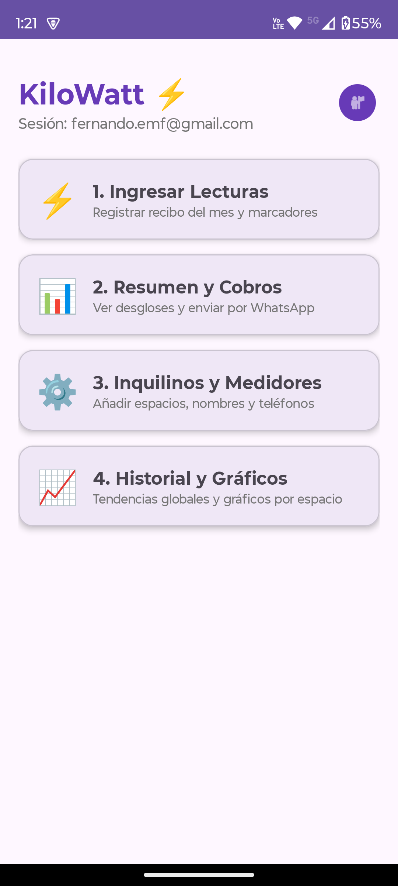
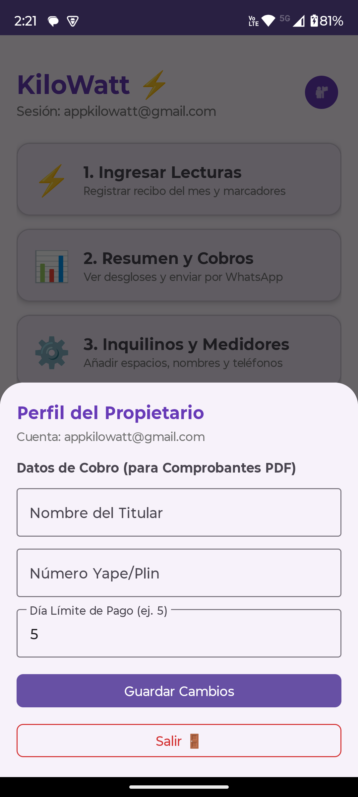
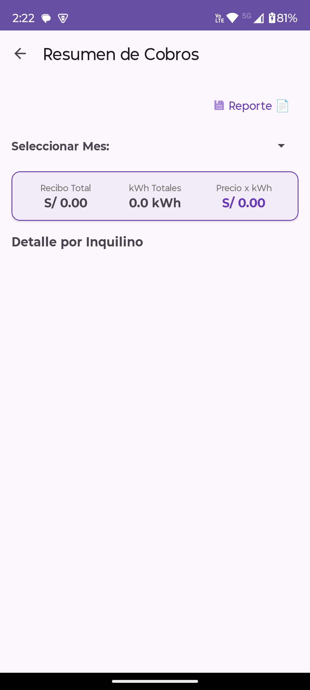
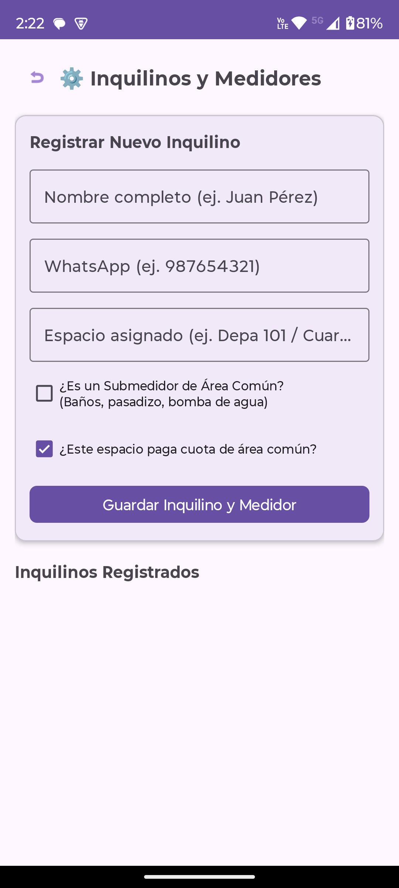

# Kilowatt ⚡ - Gestión, Prorrateo de Consumo Eléctrico y Cobranza Offline-First

**Kilowatt** es una aplicación móvil Android nativa diseñada para propietarios y administradores de inmuebles. Permite automatizar la gestión, cálculo y prorrateo del recibo de luz general entre múltiples inquilinos y submedidores independientes, funcionando al **100% Offline-First**.

---

## 📱 Capturas de Pantalla

<div align="center">
  
  
  
  
</div>

---

## 🚀 Características Principales

* **Arquitectura Offline-First (SSOT):** Consulta de datos local ultrarrápida a velocidad de 0 ms. Sincronización transparente con la nube al recuperar conexión.
* **Registro de Lecturas & Monotonicidad:** Validaciones inteligentes para evitar errores tipográficos o lecturas menores a la anterior.
* **Motor de Cálculo & Prorrateo Exacto:** Distribución matemática proporcional basada en consumo real en kWh y prorrateo de áreas comunes (bombas de agua, pasillos) entre pagadores autorizados.
* **Gestión de Cobranza & Sellos Visuales:** Seguimiento de estados de pago (`PAGADO ✅`, `VENCIDO 🔴`, `PENDIENTE 🟡`) con registro de medio de pago (Yape, Plin, Transferencia, Efectivo).
* **Generación de Comprobantes PDF:** Exportación A6 individual por inquilino y reporte general A5 con gráficos de pastel y datos bancarios/QR del propietario.
* **Distribución vía WhatsApp:** Envío de comprobantes y resúmenes estructurados directamente al chat del inquilino con un solo clic.
* **Histórico y Gráficos:** Visualización de tendencias de consumo del inmueble y por espacio con `MPAndroidChart`.

---

## 🛠️ Tecnologías y Arquitectura

* **Lenguaje:** Kotlin
* **Patrón de Arquitectura:** MVVM (Model-View-ViewModel) / Clean Architecture
* **Inyección de Dependencias:** Dagger Hilt v2.60.1 (`@HiltAndroidApp`, `@HiltViewModel`, `@AndroidEntryPoint`)
* **Persistencia Local:** Room Database v2.8.5 (Single Source of Truth) + KSP2
* **Backend Remoto:** Cloud Firestore & Firebase Auth
* **Sincronización en Segundo Plano:** Android WorkManager (`SyncWorker`)
* **Concurrencia & Reactividad:** Kotlin Coroutines & `StateFlow` (recolección segura con `repeatOnLifecycle`)
* **UI & Design:** Material Design 3 (M3), ViewBinding, `TextInputLayout.OutlinedBox`, `BottomSheetDialog`
* **Pruebas Automatizadas:** Suite de 36 pruebas unitarias integradas (JUnit 4) en verde (100% éxito)

---

## 📊 Lógica de Cálculo

La app calcula el cobro individual basándose en la proporción exacta de consumo sobre el total medido:

1. **Porcentaje de Consumo Individual:**
   $$\% \text{ Consumo} = \frac{\text{kWh Submedidor}}{\sum \text{kWh de todos los Submedidores}}$$

2. **Pago Base (Soles):**
   $$\text{Pago Base} = \% \text{ Consumo} \times \text{Monto Total del Recibo General}$$

3. **Distribución de Área Común:**
   El consumo de submedidores marcados como áreas comunes se distribuye equitativamente únicamente entre los inquilinos configurados como pagadores de cuota común.

---

## ⚙️ Configuración del Proyecto

1. **Clonar el repositorio:**
   ```bash
   git clone [https://github.com/TU_USUARIO/kilowatt.git](https://github.com/TU_USUARIO/kilowatt.git)
   cd kilowatt